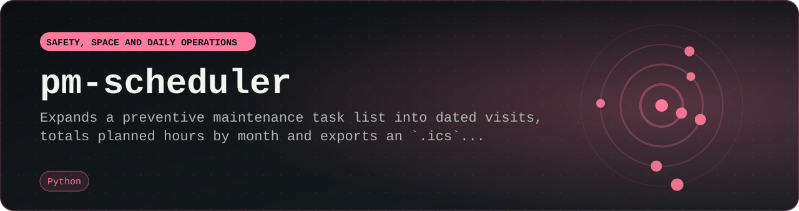
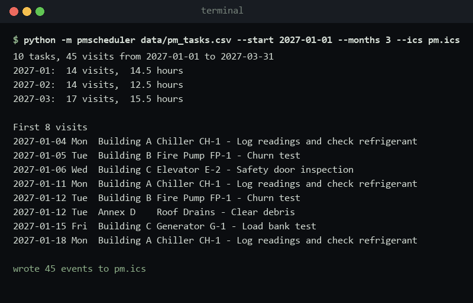

<p align="center"></p>

# pm-scheduler

[](https://github.com/yassine2med/pm-scheduler/actions/workflows/ci.yml)  

Expands a preventive maintenance task list into dated visits, totals planned hours by month and exports an `.ics` calendar file.



## What it is for

Preventive maintenance is usually a list of tasks with a frequency: filters monthly, generator load test quarterly, chiller cleaning once a year. Turning that list into dates, working out how many labour hours each month needs, and getting the visits into a calendar people actually open is manual work, and month-end dates are easy to get wrong. A maintenance planner or facility coordinator uses this tool to see the visits and the monthly workload, then imports the `.ics` file into Outlook, Google Calendar or Apple Calendar. The sample data is synthetic.

## Install

```
git clone <this repository> && cd pm-scheduler
python -m pip install -r requirements.txt
python -m pip install -e .
```

## How to use

| I want to | Command |
|---|---|
| Print the schedule for 3 months from today | `python -m pmscheduler data/pm_tasks.csv` |
| Start on a given day | `python -m pmscheduler data/pm_tasks.csv --start 2027-01-01` |
| Cover a different number of months | `python -m pmscheduler data/pm_tasks.csv --months 6` |
| Move Saturday and Sunday visits to the next Monday | `python -m pmscheduler data/pm_tasks.csv --shift-weekends` |
| Export a calendar file | `python -m pmscheduler data/pm_tasks.csv --ics pm.ics` |
| See the built-in help | `python -m pmscheduler --help` |

Worked example:

```
python -m pmscheduler data/pm_tasks.csv --start 2027-01-01 --months 3 --ics pm.ics
```

```
10 tasks, 45 visits from 2027-01-01 to 2027-03-31
2027-01:  14 visits,  14.5 hours
2027-02:  14 visits,  12.5 hours
2027-03:  17 visits,  15.5 hours

First 8 visits
2027-01-04 Mon  Building A Chiller CH-1 - Log readings and check refrigerant
2027-01-05 Tue  Building B Fire Pump FP-1 - Churn test
2027-01-06 Wed  Building C Elevator E-2 - Safety door inspection
2027-01-11 Mon  Building A Chiller CH-1 - Log readings and check refrigerant
2027-01-12 Tue  Building B Fire Pump FP-1 - Churn test
2027-01-12 Tue  Annex D    Roof Drains - Clear debris
2027-01-15 Fri  Building C Generator G-1 - Load bank test
2027-01-18 Mon  Building A Chiller CH-1 - Log readings and check refrigerant

wrote 45 events to pm.ics
```

## How it works

- Each CSV row is one task with a frequency (weekly, biweekly, monthly, quarterly, semiannual or annual), a first due date and planned hours.
- Weekly and biweekly dates are `first_due` plus a multiple of 7 or 14 days.
- Month-based dates are `first_due` plus a multiple of 1, 3, 6 or 12 months, always counted from `first_due`. A task due on January 31 falls on February 28, then returns to March 31. It does not drift to the 28th.
- Only dates from `--start` to the end of the window are kept. Visits are sorted by date, then asset.
- Hours are summed per month so you can see which months are heavy.
- Each event in the `.ics` file is an all-day event with the building as location. Its UID is a hash of the task and date, so importing an updated file replaces events and does not duplicate them.

## Limits

- All-day events only. There is no time of day, technician assignment or travel time.
- No holiday calendar. `--shift-weekends` only handles Saturday and Sunday.
- A visit is not marked done anywhere. The file is a plan, not a work order system.
- Frequencies are the six listed. Run-hour or meter-based triggers are not supported.

## License

MIT. Yassine Emhamed, 2026.
